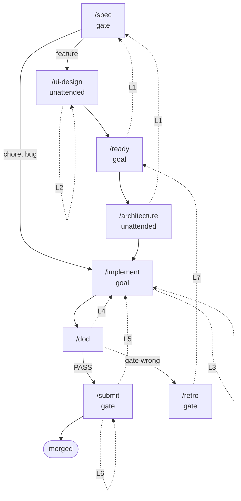

# Feature Development Loop

How the phase skills work together to drive an issue from idea to merged code.

This is a **loop**, not a pipeline: phases can route work backwards, and two phase interiors
run unattended under `/goal` until a printed condition holds.

## Overview



Reading it:

- **Solid** is the forward path. **Dotted** is a reverse edge, and the reverse edges are the
  point — a pipeline without them fails later and more expensively.
- **gate** means a human decides before the phase advances. **goal** means the phase interior
  runs unattended under `/goal` until a printed condition holds.
- **L1** through **L7** are the seven loops, described next.

## The seven loops

Each one has a trigger, an exit condition, and something that caps it. A loop with no cap is
how a phase runs forever; a loop with no printed exit condition is how it stops too early.

### Level 1 — inside a phase

**L2 · Design iteration** — `/ui-design`, run by `/spec`
- Trigger: an adversarial critic returns a blocking finding.
- Exit: no blocking findings left. No human approval per pass; the user judges the design at
  the end, or at a `design-checkpoint` when the issue sets one.
- Cap: the `effort/` tier. S and M get two passes, L four. At the cap, keep the version with
  the fewest blocking findings and send the open ones to the user (`stage:human`).

**L3 · TDD cycle** — `/implement`
- Trigger: the next acceptance criterion in the approved plan.
- Exit: the failing test passes, the tests for the touched code stay green, and the refactor
  is clean. The whole suite waits for `/dod`.
- Cap: none, and it needs none. It is per criterion, and the issue bounds the criteria list.

**L5 · Review committee** — `/submit`
- Trigger: `/code-review` returns a correctness finding, or a lens returns a blocking finding.
- Exit: every correctness and Lens B blocking finding is fixed behind a red test or dropped
  per `submit/references/finding-triage.md`, and Lens A and Lens C return zero blocking findings.
- Cap: the `effort/` tier again. Non-blocking findings are logged to the issue and dropped, so
  the loop cannot be kept alive by style preferences.

### Level 2 — between phases

**L1 · Spec repair** — `/ready` → `/spec` → `/ready`
- Trigger: a `DOR VERDICT` or `ARCH VERDICT` with `route=stage:spec`. Scope is XL, requirements are missing, or an AC
  cannot be made observable without inventing what the author meant.
- Exit: a later `/ready` run prints `status=PASS`.
- Cap: one unattended repair per run; a second route back sets `stage:human`.

**L4 · Definition of Done** — `/implement` → `/dod` → `/implement`
- Trigger: `DOD VERDICT` with `route=/implement`.
- Exit: `status=PASS` or `status=PASS-with-caveats`.
- Cap: the goal's turn limit, plus a circuit breaker — if the same criterion fails three runs
  in a row, stop and report. The problem is not the implementation at that point.
- This is the only loop that runs fully unattended, which is why `/dod` is forbidden from
  editing code or the acceptance test. Both would close the loop by removing the signal.

**L6 · Human review** — after the MR exists
- Trigger: review comments or a CI failure.
- Exit: approval.
- Cap: human. `/loop` polls for the comments because they arrive on someone else's schedule;
  this is the only place `/loop` belongs.

### Level 3 — across issues

**L7 · Process repair** — `/retro`
- Trigger: any failure anywhere above. A DoR fail, a blocking finding, a failed DoD, a defect
  that reached production.
- Exit: the amendment reached a destination — a repo-local file, an issue filed against
  the repository that ships the plugin, or a recorded one-off.
- Cap: the recurrence test. Amend only what would happen again; everything else gets a
  `LEARNINGS.md` line and stops.
- **This loop does not help the issue in front of you.** It changes the gate so the next issue
  does not repeat it. Skipping it is what turns the whole thing back into a straight line.

### Where each loop is closed

`/goal` closes L4 and the `/ready` interior. Human gates close L1, L2, L5, L6, and L7. Nothing
closes L3 but the code. Under the `autopilot` label, `/autopilot` takes the human gates per
Autopilot below, except the merge.

## The primitives and what each is for

Four different mechanisms, no overlap. Picking the wrong one is the most common mistake.

- **Skills** carry the standards. `/ready` holds the Definition of Ready rubric, `/dod`
  holds the Definition of Done procedure. They document what good looks like. They do not
  contain iteration counters.
- **`/goal`** drives phase interiors. It re-runs a turn until a condition holds, so a phase
  that needs "keep fixing until tests are green" uses a goal rather than hand-written loop
  logic. One goal per session, so goals are set per phase, never per feature.
- **Fresh-context `Agent` calls** are the review committees. The builder never grades its own
  work.
- **`/loop`** polls external state that changes without you: CI status and MR comments after
  `/submit`. Nothing else.

### The constraint that shapes every exit condition

The `/goal` evaluator **does not call tools**. It only judges what has been printed into the
conversation. Therefore every phase exit condition must be provable by a printed artifact:

- Good: a `DOR VERDICT:` line, a `DOD VERDICT:` line, a test summary with a failure count, a
  results file path with `status: PASS`.
- Useless: "the design is good", "the code is clean", "acceptance criteria are met" with
  nothing printed that shows how.

This is why the Definition of Done is a harness run. It produces a PASS/FAIL the evaluator can
read. Prose cannot close a loop.

## Definition of Ready

An issue is ready to implement when all of these hold. `/ready` audits them and prints a
pass/fail line per criterion.

- **R1 User stories** — at least one, in role/action/benefit form, each with acceptance
  criteria.
- **R2 Observable acceptance criteria** — every AC names a UI element or an app state a test
  can assert. "Feels responsive" fails. "Tapping `saveRecipeButton` shows `recipeSavedToast`
  within 2s" passes.
- **R3 Identifier contract** — every element an AC references has a named
  `accessibilityIdentifier`. Without this the DoD test cannot be written.
- **R4 Design artifact** — user-facing work has approved screens meeting the platform's
  interface guidelines (Apple HIG on Apple platforms) and the app's existing aesthetic. Missing design routes to `/ui-design`, not to `/spec`.
- **R5 Technical approach** — checked by `/architecture` after `/ready`, not here: the types
  and files to touch, the data flow, and the decisions already made.
- **R6 Bounded scope** — an `effort/` label is present and is not XL. XL routes back to
  `/spec` to be split.
- **R7 DoD test exists** — an acceptance test in the project's own harness whose
  `success_criteria` map one-to-one onto the acceptance criteria. On Apple platforms that is
  an AXe YAML under `scripts/uitests/`; on web it is the named Playwright flow. Non-UI work
  names the unit or integration tests instead. Config repos, markdown and docs work, and
  one-off scripts are exempt under the testing standard in `CLAUDE.md` and mark R7 N/A.

- **R8 Gate is set** — exactly one `gate:` label is present (`gate:machine`, `gate:human`, or
  `gate:mixed`), naming who can close the issue and whether an unattended loop may touch it.
  `/spec` sets it at sizing time; `/ready` refuses an issue whose gate is unset. This is the
  routing axis, and it is what makes the pull query below possible.

R7 is the load-bearing one. **The acceptance test is authored before any code**, which is
what makes the Definition of Done objective rather than aspirational.

## The routing axis

`value/`×`effort/` answers *how important and how big*. It does not answer *who can close this,
and can the loop touch it* — a second, orthogonal axis carried by a small set of labels:

- **`gate:machine` · `gate:human` · `gate:mixed`** — who closes it. R8, set at `/spec`, required
  by `/ready`.
- **`unattended`** — safe for the loop to pull with no human and no hardware. Set by `/ready`.
- **`blocked`** — a dependency must clear first. Set and cleared as dependencies move.

## State machine

One `stage:` label per open issue says **whose turn it is**, so any session can pick it up from
GitHub alone. Closed means done.

- `stage:spec`: owner `/spec`; next `stage:design` (feature), `stage:build` (chore or small bug
  fix), `stage:human` (a question only the user can answer), `stage:spec` (split children),
  `stage:ready` (a repaired issue).
- `stage:design`: owner `/ui-design`; next `stage:ready` (designed, or no design needed),
  `stage:human` (design-checkpoint set, or critics still block at the cap), `stage:spec` (a
  criterion the design cannot meet).
- `stage:human`: owner `/spec`, which records the user's decision; next the state the waiting
  verdict names: `stage:spec`, `stage:design` or `stage:ready`. After a `SUBMIT VERDICT` the
  user reviews the PR, and merging closes the issue.
- `stage:ready`: owner `/ready`; next `stage:architecture` (pass), `stage:design` (design missing
  or a blocking finding open), `stage:spec` (scope, stories or criteria fail).
- `stage:architecture`: owner `/architecture`; next `stage:build` (technical notes filed),
  `stage:spec` (the code contradicts the spec).
- `stage:build`: owner the build run: `/implement`, or `/autopilot` under the `autopilot` label; next `stage:human` (PR open).
- `stage:review`: reserved for stakeholder review after done (not built yet).

An issue with no `stage:` label goes to `/spec`.

Every owner follows the same rules:

1. **Entry check.** Run only when the label is one you own. Otherwise stop and name the owner.
2. **Verdict comment.** Every transition posts one issue comment: the verdict line
   (`<STAGE> VERDICT: #N route=stage:<next> blocking=<what, or none>`), two or three plain
   sentences on what the stage did or decided, and links to anything longer. A skipped stage
   posts one too ("no design needed"). The skill that resumes from `stage:human` posts the
   user's decision. The comments are the issue's audit trail; a label change with no verdict
   after it marks a stage that died halfway.
3. **Last action.** Set the next label after the verdict comment, removing your own. A crash
   leaves your label on, so resuming re-runs your stage and never skips it.

A loop that wants a next item it can actually finish queries the label side:

```
highest value/, lowest effort/, unattended AND gate:machine, NOT blocked
```

The consuming loop adds its own open/status filter on top (a Project board's `status=Todo`, or
just "issue is open"). That board and its status field live in the consuming repo, not in
dev-jawn — dev-jawn only exposes the labels the query needs.

Both axes are defined once, with colors and descriptions, in
`plugins/dev-jawn/scripts/setup_labels.sh`. A project adopts the taxonomy by running that script
once (`bash plugins/dev-jawn/scripts/setup_labels.sh`); see `plugins/dev-jawn/README.md` for the
full table and the GitLab translation.

**`polish` (✨) is a work-type tag, not routing.** It answers neither "who closes it" nor "can
the loop touch it," so it stays out of the Definition of Ready and out of the pull query. Treat
it like `bug` or `documentation`: a category, not a gate.

## Definition of Done

Three things hold, and `/dod` is what establishes them:

- The unit suite is green, with pristine output.
- The acceptance test written at `/ready` passes against the built app.
- Every acceptance criterion reconciles to the channel that observed it. An AC with nothing
  reporting on it is a FAIL, not a skip. This is the check that catches a green suite that
  never exercised half the feature.

`/dod` detects the platform, runs the right harness, writes
`scripts/uitests/results/YYYY-MM-DD_HHMM_<name>.md`, and prints:

```
DOD VERDICT: #347  status=FAIL  criteria=7/9  unit=green  acceptance=FAIL  results=<path>  route=/implement
```

A code failure routes to `/implement`. A test that asserts something the acceptance criteria
never said routes to `/retro`, because then the gate is wrong rather than the code.

## The phases

### `/spec <description>` — human gated, then unattended

Requirements and design. With the user: user stories, scenarios, Given/When/Then acceptance
criteria, guardrails (design constraints, non-goals, stop conditions, rules), the
`design-checkpoint` and `merge` flags, sizing. One gate before filing. Then, unattended, it
runs each next owner per State machine: `/ui-design`, `/ready`, `/architecture`. Chores and
small bug fixes go straight to `stage:build`.

- Every Then must be observable by a command or test (R2), and behavioral, not visual.
- XL never gets filed; it splits into S to L children.

### `/ready #N` — unattended under `/goal`

Audits the issue against the Definition of Ready, **repairs what it can**, and routes what it
cannot. It rewrites vague ACs into observable form, names missing identifiers, derives the
acceptance test, creates the feature branch, and commits the test.

Prints a fixed verdict line the goal evaluator reads:

```
DOR VERDICT: #347  status=PASS  passed=7/7  blocking=none  route=/ui-design
```

Routes: `/spec` when the problem is scope or missing requirements, `/ui-design` when only the
design is missing, `/implement` when ready and no UI work is needed.

### `/ui-design #N` — unattended, run by `/spec`

Design passes, up to the count the size gate allows. Each pass builds the **real view**, not a
throwaway mock, and drives it for the empty, typical, and stress states: Playwright against a
live prototype URL on web, `mcp__xcode__RenderPreview` on Apple platforms. Then four
fresh-context adversarial critics try to break it, one lens each:

- Spec fit: a Given/When/Then it cannot satisfy, or a screen the guardrails forbid
- States: empty, error, loading, long text, largest Dynamic Type or zoom
- Accessibility: keyboard path and focus order, contrast, tap target size; VoiceOver on Apple
  platforms, WCAG on web
- Platform conventions and fit with the app's existing aesthetic

Each reviewer returns a **blocking finding count**. Only blocking findings force another
pass; non-blocking findings are logged to the issue and dropped. Without that rule three
passes always runs three passes.

On Apple platforms the final pass builds and drives the view in the simulator with AXe, so the
design is confirmed interactively using the same harness that will run the DoD test.

No pass waits for you. The design log (each pass, what critics blocked, what changed) and the
screenshots go on the issue, and you judge the result at the end, or at the
`design-checkpoint` when the issue sets one.

### `/architecture #N` — unattended, after `/ready`

The domain architect (swift, python, cpp-qt) designs how to build the issue from its stories,
guardrails and design, following the repo's own stack. It fills the issue's Technical Notes and
applies R5 as its exit check. When the code contradicts the spec, it routes back to `/spec`
instead of designing around it.

### `/implement #N` — unattended under `/goal`

Plan mode and plan approval are still a human gate. After the plan is approved, the
implementation runs under a goal whose exit condition is a `DOD VERDICT` line with
`status=PASS`. `/dod` runs inside that loop and produces it.

Two rules hold no matter how many times the loop runs: the acceptance test is never edited to
make it pass, and no unit test is weakened. Both are the same failure — removing the only
signal that says whether the work is done.

### `/submit` — human gated

Confirms a `DOD VERDICT` exists for the issue, then reviews the branch before the MR is
opened. Two parts:

The **generic sweep** is the built-in `/code-review` skill, run at the level the size gate
names. It owns correctness bugs and reuse/simplification/efficiency cleanups, so dev-jawn
does not hand-maintain a bug-hunting prompt. Its correctness findings go through
`submit/references/finding-triage.md`; the rest are logged and dropped.

The **lenses** run in fresh contexts and cover what `/code-review` structurally cannot:

- Lens A, acceptance-criteria conformance — `/code-review` reads the diff, not the issue, so
  nothing else checks the code against what the ticket asked for. Always on.
- Lens B, platform safety, via the domain reviewer: Swift concurrency and main-actor safety on
  Apple platforms, the `python-code-reviewer` or `cpp-qt-reviewer` skill elsewhere.
  `effort/M` and up.
- Lens C, test adequacy: would each test still fail if the fix were reverted. `effort/L` only.

Lens A and Lens C ship as agent definitions under `plugins/dev-jawn/agents/`, each pinning
`model: opus`, so committee depth does not follow `/submit`'s orchestration effort or the
session's `/model`. Agents take no `effort:` key.

Blocking findings stop the submission; non-blocking ones are logged and dropped. After the MR
exists, `/loop` handles polling for CI and review comments.

### `/retro` — after any failure

When DoR fails, a committee blocks, or the DoD test fails, name the gate that should have
caught it, amend that gate, and record the entry. Without this the loop is a longer straight
line.

Where the amendment goes is a scope decision, and `/retro` never edits the plugin source to
make it. A lesson that recurs only in this project is written to `.dev-jawn/<skill>.md` in
the repo you are working in. One that recurs anywhere is filed as an issue against the
repository that ships the plugin, resolved from the plugin's marketplace entry. Either way
it is separate from the fix for the issue.

Amend only what would recur. A retro that files an amendment for every failure buries the
rubric in special cases until nobody reads it, which is the same as having no rubric. A
genuine one-off gets a `LEARNINGS.md` line and nothing more.

## Size gating

Committee cost scales with the `effort/` label. `/ready` records the gate in the issue so
later phases do not re-derive it.

Every design pass runs four adversarial critics: spec fit, states, accessibility, platform fit.

- **effort/S** — up to two design passes. Code review: `/code-review low` + Lens A.
- **effort/M** — up to two design passes. Code review: `/code-review medium` + Lens A + Lens B.
- **effort/L** — up to four design passes. Code review: `/code-review high` + Lens A + Lens B
  + Lens C.
- **effort/XL** — does not pass DoR. Split it first.

## Gates

Nothing crosses these without you, except under the `autopilot` label (see Autopilot).

- `/spec` before filing: file this spec and start design?
- `/ui-design` when the issue sets `design-checkpoint` or critics still block at the cap
  (`stage:human`): approve, iterate, or change the spec?
- `/implement` after plan: plan approved?
- `/submit` after review: merge?

`/ready` and `/dod` have no gate. Each one passes, repairs, or routes, and every outcome is
printed.

`/retro` proposes an amendment to a standard you rely on across every project. It never lands
one on its own.

## Autopilot

An issue with the `autopilot` label runs hands-off from spec to an open PR, with one stop at the
end. `/autopilot #N` (or `/autopilot <description>`) adds the label and drives the run; any
session that picks the issue up from GitHub sees the label and keeps going the same way.

The rule every phase follows while the label is on:

- **Every gate takes its `(Recommended)` option** instead of asking: the `/spec` questions and
  filing gate, the `/ui-design` checkpoint, plan approval, the TDD exception gate, and any
  mid-run question (a contradiction found while building, a scope fork). Post it as an issue
  comment, `DECISION: #<N> gate=<which> chose=<option> why=<one line>`, and continue. A
  question with no recommended option picks the one that keeps the issue's scope, and files
  the rest as a follow-up issue.
- **`[manual]` criteria wait for the end.** `/dod` records each one's proxy result and marks
  the criterion `deferred`. With everything else passing, the verdict is
  `status=PASS-pending-manual`, which lets `/submit` open the PR but never merge. The final
  report asks for each one.
- **Test changes the run may make without asking, each logged as a `DECISION:`:** test setup
  that changes no assertion, and a criterion added after the `DOR VERDICT` (at plan time or
  mid-build), with the measurement that justifies the change in the comment. An existing test
  the change makes false, found mid-build, is such a criterion: the comment names the old
  check and the new one. `/architecture` should have listed it; one it missed is a `/retro`
  note. It still never
  weakens an assertion, deletes a test, or edits the acceptance test `/ready` committed; a
  criterion that test covers still stops the run.
- **What still stops the run:** a route to `/retro`, the three-failure circuit breaker, a
  second route back to `/spec`, and anything that would destroy data or touch production. Set
  `stage:human`, post why, and report.
- **The one planned stop is the merge.** `/submit` opens the PR, then the final report lists
  the deferred `[manual]` criteria with their evidence, every `DECISION:` taken, and ends
  with a typed stop: the user replies `merge` (or feedback) as plain text, not through a form.

## Phase closeout

Every phase ends with a report to the product owner, not to another developer. Joe reads it
without the issue open, so it has to make sense on its own. It is layered: the first layer is
short enough to read at a glance, and anything deeper prints only when he asks.

### Layer 1: always printed

1. **Status, in a few plain sentences he can read at a glance.** Say where the feature stands, what a user can
   now do (or what is broken, described as a user would notice it), and anything he would be
   surprised to learn later: a caveat, a skipped check, a change from the plan.
2. **The gate**, when the phase has one. A single-line AskUserQuestion question with fixed
   options. Always include `Tell me more` and `Stop here`. Put the recommended option first.
3. **The machine line last**, when the phase prints one (`DOR VERDICT`, `DOD VERDICT`,
   `RETRO`), in exactly the format its skill defines.

A phase that routes on its own with nothing to decide (`/ready`, `/dod`, a failing loop
iteration) prints Layer 1 without a gate and says whether it is continuing or stopping.

### Layer 2: `Tell me more`

What deserves his attention, one short paragraph each: every caveat or failure with why it
matters and what the options are, and every change from the plan with its effect on users or
cost. Then ask the same gate again, with `Show every check` replacing `Tell me more`.

### Layer 3: `Show every check`

One plain line per acceptance criterion: what it checks, in user terms, and whether it passed.
End with the path to the results file or the issue comment that holds the evidence.

### Rules for every layer

- **Never refer to a criterion by its ID.** "AC4" means nothing without the issue open.
  Describe the behavior, or quote the criterion's text.
- **Say it in product terms.** File names, test names, commit counts, and branch names stay
  out unless he asks. They live in the results file, the PR, and git.
- **No emoji, no celebratory headers, no claims past what happened.** `/submit` merges; it
  does not deploy.
- **Unknowns are stated, not smoothed over.** "Checked on the simulator only" belongs in
  Layer 1 if it could change his decision.

Example, `/implement` passing with a caveat:

```
Spotlight search is built. Typing now shows matching recipes as you type.
All 9 checks pass, with one caveat: speed was only measured on the simulator.

Send it to code review?
  1. Submit (Recommended)
  2. Tell me more
  3. Keep working
  4. Stop here

DOD VERDICT: #347  status=PASS-with-caveats  criteria=9/9  unit=green  acceptance=PASS  results=scripts/uitests/results/2026-09-13_1412_spotlight.md  route=/submit
```

## Entry points

- Fresh idea: `/spec <description>`
- Hands-off, from idea or issue to an open PR: `/autopilot <description>` or `/autopilot #N`
- Existing issue of unknown quality: `/ready #N`
- Existing issue in an older format: `/spec #N` (re-spec)
- Issue that still owes its design: `/spec #N design`
- Ready issue, no UI: `/implement #N`
- Code already written: `/submit`
- Something got through that should not have: `/retro`

**Default to `/ready` for anything already filed.** It is cheap when the issue is in good
shape and it is the whole point when it is not. Going straight to `/implement` requires that
the issue already carries a passing `DOR VERDICT` and its committed acceptance test, or that
Joe said to skip the gate.

## Standalone utilities

- `/git-analysis` — repository health, not part of the loop.
- `/dod #N` — run the DoD test on demand, outside `/implement`.
